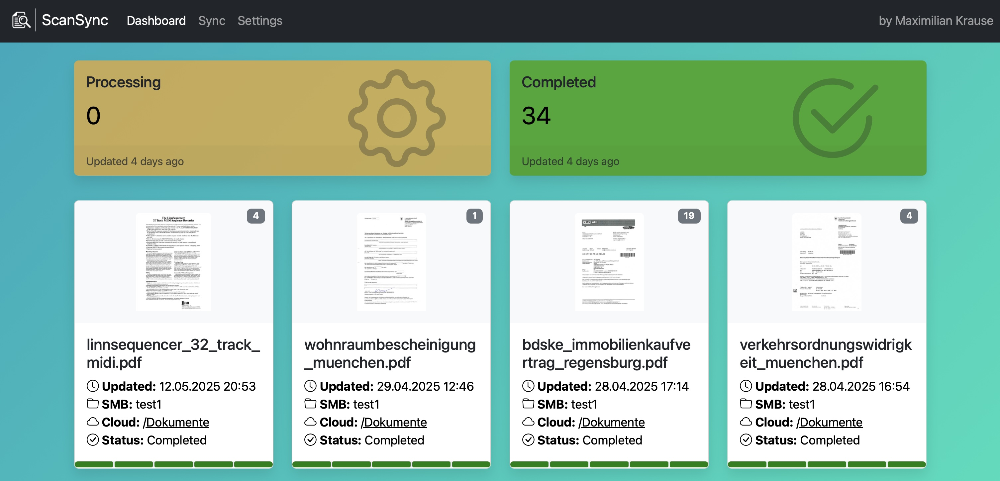

[](https://github.com/maxi07/ScanSync/actions/workflows/pytest.yml)


# ScanSync

ScanSync is a Python application designed to streamline document management by:
- Creating an SMB server with custom targets.
- Performing OCR (Optical Character Recognition) with [OCRmyPdf](https://github.com/ocrmypdf/OCRmyPDF) on new documents in English (ENG) and German (GER).
- Syncing documents to a specified location within your OneDrive.
- Renaming files intelligently using [OpenAI](https://www.chatgpt.com) or your local [Ollama](https://www.ollama.com) server.
- Ensuring redundancy with [RabbitMQ](https://www.rabbitmq.com).
- Supporting multiple sync targets.



## 🚀 Features
- **SMB Server**: Easily connect and manage your documents.
- **OCR Support**: Automatic text recognition in multiple languages.
- **OneDrive Integration**: Seamless syncing to your preferred location.
- **AI-Powered File Renaming**: Smart renaming using using [OpenAI](https://www.chatgpt.com) or your local [Ollama](https://www.ollama.com) server..
- **Redundancy**: Reliable document handling with RabbitMQ.
- **Multiple Sync Targets**: Flexibility to sync across various locations.

## Why this project?
I ran into the following issue: I wanted to scan a document using a regular network scanner, OCR that file and move it automatically to SharePoint or OneDrive. There are ver expensive scanners that do have that option, but buying new hardware was out of scope. Then there also is 3rd party software, but it usually requires paid cloud services and subscriptions: Not suitable for a small business or even personal use. Therefore this application, that enables you to use a regular network scanner, make the document searchable by running OCR and then automatically pushing it into your desired OneDrive location. No big hastle, everything local and for free (except the optional OpenAI file naming, but the cost is in the cents.)


## 📦 Installation

1. Clone the repository:
   ```bash
   git clone https://github.com/maxi07/ScanSync.git
   ```
2. Install dependencies:
   - [Docker](https://www.docker.com)
   - [Docker Compose](https://docs.docker.com/compose/install/)
3. Start the application:
   ```bash
    make prod-build prod-start
   ```

Once started:
- Connect to the SMB server using:
  - **Username**: `ocr`
  - **Password**: `ocr`
  - **Share**: `Scans`
- Access the web server at your server's IP on port `5001`.
- Setup your onedrive connection, add a smb share and start scanning

## RabbitMQ Monitoring

RabbitMQ runs as a single node. The configuration explicitly lists the local
Docker hostname as its only peer and disables the deprecated management metrics
collector. The management UI and live queue totals remain available on port
`15672`, but historical charts and detailed rate statistics are disabled.
The startup notice about disabled metrics collection is expected.

The shared publisher uses a dedicated I/O thread to process heartbeats even when
no documents arrive or a service is busy with OCR, AI, or uploads. All operations
on that connection stay on the same thread, while publishing helpers still wait
for their result. Increasing the heartbeat timeout alone does not prevent idle
disconnects when Pika's event loop is not being serviced.

A message about rebuilding message-store indices can occur during initialisation
or recovery; it does not by itself prove message loss. Repeated rebuilding after
normal, clean restarts warrants checking storage and shutdown behaviour.

After changing [rabbitmq.conf](rabbitmq.conf), apply it with
`docker compose restart rabbitmq`; no image rebuild is needed. This briefly
interrupts broker connections, so restart when no documents are being processed.

## Optional Analytics

Telemetry is **off by default**. To enable it, configure both variables in a
`.env` file next to the Compose file, then rebuild/recreate the services:

```dotenv
ANALYTICS_URL=https://your-analytics-server.example
ANALYTICS_API_KEY=your-scansync-project-api-key
```

If either variable is empty, nothing is sent and no analytics worker starts.
The endpoint must implement the maexbert-analytics `POST /event` API.
Sending is fire-and-forget: analytics failures never stop document processing,
and events can be lost when the endpoint is unavailable or services stop.
The first delivery failure is logged locally once per process, with an HTTP
status or technical reason. It never generates a recursive analytics event.
No document content, filenames, paths, credentials, usernames, or hostnames
are sent. The top-level `user_id` is a random, pseudonymous installation ID
persisted in the shared data volume, not a person or PC name. Tracebacks
contain only module/function names and line numbers, never exception
messages, source lines, or local variables.

See the [event catalog and SQL examples](doc/analytics.md) for all available
events, metadata, counting rules, and delivery limitations.

## 🛠 Development

```bash
make dev-start
make dev-restart
make dev-logs
make dev-stop
```

Development adds [docker-compose.dev.yml](docker-compose.dev.yml) to the production
configuration. Python service sources and the shared library are mounted read-only;
Flask reloads automatically. Use `make dev-restart` after worker or shared-library
changes. Dependency changes are installed by the next cached `make dev-start` build.
Development and production deliberately share the same Compose project and data:
switch modes with the respective start command, rather than running both at once.
For a fully isolated concurrent stack, use a separate clone, `COMPOSE_PROJECT_NAME`,
and distinct container names and published ports.
Override the web port when needed: `WEB_PORT=5002 make dev-start`.

### Builds and Updates

`make start` is an alias for `make prod-start`: it starts existing images without
rebuilding them, building only images that do not exist yet. After changing code,
dependencies, or checking out a new release, use `make prod-build prod-start`.
Production never mounts application source files. `make restart` only restarts
containers; it does not apply image or configuration changes.

Docker caches native tools and Python dependencies independently of application
source and `APP_VERSION`. The OCR image uses a separate native build stage, so
compilers and source archives are not included in its runtime image. A pip download
cache accelerates dependency rebuilds, and [.dockerignore](.dockerignore) excludes
local environments, caches, Git history, and secrets from the build context.

Python direct dependencies remain pinned in each service and in
[scansynclib/pyproject.toml](scansynclib/pyproject.toml). All Python images use
[requirements-dev.txt](requirements-dev.txt) as constraints, including transitive
versions. After changing direct pins, regenerate it with:

```bash
python3 -m pip install --upgrade pip pip-tools
make deps-lock
make test
make prod-build prod-start
```

`deps-lock` updates transitive dependencies within the direct pins; it does not
silently change direct versions. Weekly grouped Dependabot PRs propose updates
to Python, npm, container images, Compose services, and GitHub Actions. Review
these updates, regenerate the constraints, and run tests before deployment.
CDN versions and native source pins (including Ghostscript's archive checksum)
must also be reviewed when updating dependencies.

Use `make prod-refresh` or `make dev-refresh` periodically to pull service/base
images and rebuild without layer caching, refreshing apt/apk packages even if the
base tag has not changed. These commands do not update pinned Python or native
source versions. They are intentionally separate from normal starts: arbitrary
package changes on every boot would make deployments unpredictable.

### Tests

`make test` runs the real OCR/PDF-A regression, Python/browser tests, and JavaScript
tests. Test containers use a separate `scansync-test` project without published host
ports; their volumes are removed on success and failure. `make test-ocr` runs only
the real Ghostscript test, including synthetic embedded fonts with `fi`/`fl`
multi-character ToUnicode mappings and a check of the output PDF/A declaration.

#### End-to-end scenarios

Run `make test-e2e` with Docker Compose 2.24.4 or newer and Docker running. No
Python, browser, SMB client, provider account or real API key is required on the
host. The same command runs for every pull request in the **End-to-End Tests**
workflow. To make it a merge requirement, select **Browser, SMB and OCR** in the
repository's branch protection or ruleset settings.

The runner creates a new, empty Compose project per invocation, publishes no host
ports, and removes its containers and volumes even after a failure. It does not
use the development or production volumes. Allow several minutes for image
builds, plus approximately seven minutes for the scenarios on a warm build.
`invalid.pdf` intentionally exercises the unchanged five-minute incomplete-file
validation timeout.

Chromium runs headlessly and performs the setup, Microsoft device-code approval,
folder selection, status observation, log inspection, failed-document download
and deletion through the UI. Documents enter via real SMB3, followed by the real
RabbitMQ, metadata, OCRmyPDF, naming and upload workers. SQLite and the scan volume
are mounted read-only in the test runner for additional integrity checks; tests
do not seed settings, tokens, jobs or application database rows.

Only Microsoft identity/Graph and OpenAI HTTP responses are simulated. The actual
MSAL and OpenAI clients still execute. Workers have no external network route;
the browser runner has internet access for the application's existing CDN assets.
The simulator rejects unexpected provider endpoints and retains actual uploaded
PDF bytes for content checks. No real credentials or GitHub Actions secrets are
used. The HTTP redirection hook is mounted only in the E2E stack, never included
in a production service image.

| Scenario | Assertions |
| --- | --- |
| SZ1 | Empty installation, navigation/settings tabs, OneDrive login, OpenAI key validation and two folder mappings |
| SZ2 | `cardinal.pdf`: four searchable PDF/A pages, generated filename, upload, local cleanup and live completion in two browser tabs |
| SZ3 | Identical SMB input in two targets produces one OCR/naming job and byte-identical uploads to both folders |
| SZ4 | `aspect.pdf` (one searchable page), `blank.pdf` (one page, `NO_TEXT`, original name), `graph_ocred.pdf` (existing text), `multipage.pdf` (six searchable pages), `invalid.pdf` (rejected, retained and downloadable, no upload) |
| SZ5 | OpenAI HTTP 500, SDK retries, original-name fallback, successful upload and visible error log |
| SZ6 | Upload HTTP 503, `Sync Failed`, byte-identical retained original, removed OCR intermediate, real browser download, successful SMB resubmission and explicit UI deletion of the old failure |

There is currently no retry button. SZ6 deliberately exercises the available
recovery path: download the original and resubmit it to SMB. The failed original
remains available until explicitly deleted; the OCR intermediate is removed.

Select a subset with `make test-e2e E2E_ARGS='-k sz6'`. Every invocation still
performs the complete first-start configuration, so subsets do not depend on a
previous test run. Tests are sequential and share only that configured application;
provider faults and recorded uploads reset between scenarios.

Diagnostics are written to `tests/e2e/artifacts/` (overwritten on the next run):
JUnit XML, screenshots, service logs, and on failure browser HTML/console logs,
provider call history and pipeline job snapshots. CI uploads these for seven
days. These generated files are excluded from Git and Docker build contexts.
The six PDFs in `tests/resources/` must be included in the repository checkout.

#### CI build caches

Both Docker test workflows build with Buildx/Bake and a GitHub Actions layer
cache per image, configured in `docker-bake.ci.hcl`. `mode=max` retains the native
Ghostscript/JBIG2 intermediate stages as well as Python dependency layers. The
Python and E2E jobs share caches for identical images. Prepared images are loaded
into Docker, then `SCANSYNC_PREBUILT=1` prevents the test commands from rebuilding
them. Local runs still build normally by default.

The E2E workflow uses `E2E_PROJECT_NAME=scansync-e2e-ci` so the prepared image tags
match Compose. Its volumes are still created from scratch and removed afterward.
Only build layers and npm/pip downloads are cached, never test results, scan
volumes, SQLite databases or provider tokens. The first run populates the caches;
later runs reuse unchanged layers. The real five-minute invalid-PDF validation
timeout is intentionally unaffected.

Ghostscript 10.08.0 fixes the warning about versions before 10.7.0. The regression
confirms preservation of the tested two-character ligature mappings. A separate
synthetic three-character `ffi` mapping was still rewritten incorrectly by 10.08.0;
this upstream limitation remains, so the upgrade is not a guarantee of text
integrity for every possible complex-script mapping.


## 📡 API

### `GET /health`

Returns HTTP 200 with `{"ok": true}` when the web process can serve requests,
without database queries, template rendering, or downstream service checks.
Compose probes this endpoint every 60 seconds, or every 3 seconds during the
30-second startup grace period. Health probes do not produce HTTP analytics
events.

### `GET /health/services`

Returns `{"ok": true, "services": {...}, "checked_at": ...}` with HTTP 200
when all configured services are available, or HTTP 503 with per-service details
otherwise. Results are cached for 30 seconds; this endpoint also emits no HTTP
analytics. It is not used as the web container's healthcheck, because workers
wait for the web service during startup.

- Workers publish one atomic heartbeat file per container in the existing data
  volume under `health/`, every 15 seconds. A worker is ready while its main
  thread is alive and its RabbitMQ connection/channel is open. Records expire
  after 60 seconds; idle workers and long-running jobs remain healthy. This is
  an availability check, not a document-progress or deadlock detector.
- Worker Docker healthchecks read only their own heartbeat. The overview checks
  every expected replica, ignoring expired records from previous containers.
  Compose sets `HEALTH_WORKER_REPLICAS` to `{"ocr_service":2,"metadata_service":2}`;
  other workers default to one instance. Update this JSON mapping when scaling.
  The E2E configuration overrides both counts to one.
- Redis is checked with `PING`. The overview checks RabbitMQ and SMB TCP
  listeners, not queue processing, SMB credentials, or share permissions.
  Their local Docker checks use RabbitMQ diagnostics and `smbcontrol smbd ping`.
- New container checks run every 60 seconds, with shorter startup intervals.
  RabbitMQ retains its existing check interval. No external cloud APIs are called.

Docker marks failed checks as `unhealthy`; that alone does not restart a container.

### `GET /api/status`

Returns aggregated document processing status including per-stage breakdowns, currently processing items, and recent completion history.

**Response fields:**

| Field | Type | Description |
|-------|------|-------------|
| `processed_pdfs` | `int` | Count of completed documents |
| `processing_pdfs` | `int` | Count of in-progress documents |
| `latest_processing_timestamp` | `string\|null` | Most recent processing update timestamp |
| `latest_completed_timestamp` | `string\|null` | Most recent completion timestamp |
| `latest_created_name` | `string\|null` | Filename of the latest document |
| `latest_created_status` | `int\|null` | Status code of the latest document |
| `total_pdfs` | `int` | Total document count across all statuses |
| `failed_pdfs` | `int` | Count of failed documents |
| `avg_processing_seconds` | `float\|null` | Average processing time for completed documents |
| `processing_details` | `array` | Breakdown of in-progress documents grouped by status |
| `currently_processing` | `array` | List of individual documents currently being processed |
| `recent_files` | `array` | Last 5 completed or failed documents with timestamps |

<details>
<summary>Example response</summary>

```json
{
  "processed_pdfs": 10,
  "processing_pdfs": 3,
  "latest_processing_timestamp": "2024-06-01 12:00:00",
  "latest_completed_timestamp": "2024-06-01 11:30:00",
  "latest_created_name": "invoice.pdf",
  "latest_created_status": 2,
  "total_pdfs": 15,
  "failed_pdfs": 2,
  "avg_processing_seconds": 45.68,
  "processing_details": [
    {"status": "OCR Processing", "status_code": 2, "count": 2},
    {"status": "Reading Metadata", "status_code": 1, "count": 1}
  ],
  "currently_processing": [
    {
      "id": 12,
      "file_name": "scan1.pdf",
      "status": "OCR Processing",
      "status_code": 2,
      "created": "2024-06-01 12:00:00",
      "pdf_pages": 3
    }
  ],
  "recent_files": [
    {
      "id": 11,
      "file_name": "doc1.pdf",
      "status": "Completed",
      "status_code": 5,
      "created": "2024-06-01 10:00:00",
      "completed": "2024-06-01 10:01:00",
      "pdf_pages": 2
    }
  ]
}
```

</details>

## 🔮 Upcoming Features
- **Notifications**: Stay informed with real-time updates.
- **OCR Settings**: Take control of OCR settings in the web interface


Thank you for using ScanSync! If you encounter any issues or have feature requests, feel free to open an issue on the [GitHub repository](https://github.com/maxi07/ScanSync).
